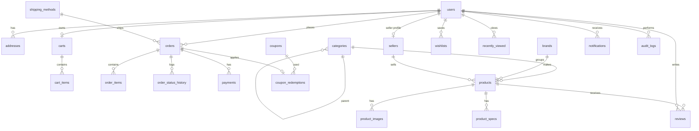

# LemboShop — Architecture & Implementation Plan

Status: **Phase 1 (inspect & plan)** — no application code written yet.

## 1. Findings from inspection (2026-10-28)

| Item | State |
|---|---|
| Project folder `…\Projekte\LemboShop` | Empty (not a git repo) |
| `C:\xampp` | **Incomplete** — only empty `apache/bin`, `php/ext`, leftover logs and a `phpMyAdmin/tmp` folder (~1.4 MB total). No `php.exe`, no `mysql`, no `htdocs`. |
| PHP / MySQL on PATH | None |

Consequence: nothing can be executed or tested until XAMPP (PHP 8.2+, MariaDB 10.4+) is reinstalled.

## 2. Architecture

Plain PHP 8, no framework. Each public page is a thin controller script that:

1. `require`s `includes/bootstrap.php` (config, autoloader, session, error handling, CSRF),
2. calls services/repositories for data and business rules,
3. renders a template from `templates/` with escaped output.

```
LemboShop/
├── index.php, products.php, product.php, category.php, search.php
├── cart.php, checkout.php, order-success.php, wishlist.php
├── login.php, register.php, logout.php, contact.php, page.php, 404.php
├── account/          dashboard, orders, order, profile, addresses, password,
│                     wishlist, reviews, notifications, settings
├── admin/            index (stats), products, product-edit, categories, orders,
│                     order, customers, reviews, coupons, inventory, shipping,
│                     banners, messages, reports, settings, users, audit-log
├── seller/           (Phase 8, optional) dashboard, products, orders, apply
├── api/              JSON endpoints (POST + CSRF): cart, wishlist, search-suggest,
│                     newsletter, reviews, chatbot
├── config/           config.php (reads .env)            ← denied via .htaccess
├── includes/         bootstrap.php, helpers.php (e(), url(), money(), …)
├── classes/          Core: Database (PDO), Env, Session, Auth, Csrf, Validator,
│                     Flash, Paginator, RateLimiter, Uploader, View, Logger
├── services/         ProductRepository, CategoryRepository, CartService,
│                     CouponService, ShippingService, OrderService,
│                     ReviewService, NotificationService, AuditLogger,
│                     ReportService, GroqClient, LemboBotService
├── templates/        layouts/{store,account,admin}.php, partials/, components/
├── assets/css/       tokens.css, base.css, components.css, store.css, admin.css
├── assets/js/        app.js (toasts, modals, menus), cart.js, search.js,
│                     gallery.js, filters.js, lembobot.js, admin.js
├── assets/images/    brand assets, seed product images
├── uploads/products/ admin uploads (git-ignored, PHP execution disabled)
├── storage/          logs/, cache/ (git-ignored, denied via .htaccess)
├── database/         lemboshop.sql (schema + demo data)
├── bin/              create-admin.php (CLI only)
├── docs/             PLAN.md, screenshots/
├── .htaccess, .env.example, .gitignore, README.md
```

Note: in the spec the SQL filename is garbled; the file will be **`database/lemboshop.sql`**.

### Cross-cutting decisions

- **Config/secrets**: `.env` (git-ignored) parsed by a tiny `Env` class; `.env.example` with placeholders. `APP_ENV=production` hides errors and logs to `storage/logs`.
- **Directory protection**: XAMPP serves the whole project, so `config/`, `classes/`, `services/`, `includes/`, `templates/`, `storage/`, `database/`, `bin/` each get `Require all denied`. `uploads/` gets `php_flag engine off` + deny for script extensions.
- **Auth**: `password_hash` (bcrypt/argon2id), `session_regenerate_id(true)` on login/role change, HttpOnly + SameSite=Lax cookies, idle timeout. Roles: `customer`, `staff`, `admin` (+ seller profile in Phase 8). Every admin/account page calls `Auth::requireRole()` server-side; every record lookup is scoped by owner (`WHERE id = ? AND user_id = ?`).
- **CSRF**: per-session token, required on every POST (forms + `X-CSRF-Token` header for fetch).
- **Money**: `DECIMAL(10,2)` in DB; integer cents in PHP arithmetic to avoid float drift. All totals recomputed server-side from DB prices.
- **Checkout integrity**: one DB transaction — `SELECT … FOR UPDATE` on product rows, verify stock, insert order + items (price snapshots), decrement stock, record coupon redemption, commit. A one-time checkout token (unique `orders.idempotency_key`) blocks double submits.
- **Cart**: guests → session; logged-in → `carts`/`cart_items`; on login the session cart is merged (quantities capped at stock).
- **Checkout requires an account** (login/register from checkout keeps the cart). Keeps order ownership and history simple and IDOR-safe.
- **Rate limiting**: `rate_limits` table keyed by hashed IP/user + scope (login, register, chatbot, contact).
- **Uploads**: MIME check via `finfo`, `getimagesize`, size cap (e.g. 4 MB), re-encode with GD, random hex filenames.
- **Emails**: XAMPP has no mail transport; confirmation "emails" are written to `storage/logs/mail.log` plus an in-app notification. Clearly documented, not faked.
- **Payments**: `cod` and `demo` only. The demo method records a simulated payment row labelled as such; no card fields exist.
- **LemboBot**: `api/chatbot.php` → `LemboBotService` retrieves matching products from the DB (fulltext + category/price parsing), passes them as JSON context to Groq via cURL with a strict system prompt (only quote prices/stock from context, no order data, no actions). Model, timeout, and key from `.env`. Missing key → endpoint returns `{available:false}` and the widget shows "LemboBot is currently unavailable". History lives in the PHP session (last N turns), input capped at ~500 chars, rate-limited.

## 3. Database schema (MariaDB 10.4+, InnoDB, utf8mb4)



### Tables

**Identity**
- `users` — id, name, email (UQ), password_hash, phone, role ENUM(customer, staff, admin), status ENUM(active, suspended), last_login_at, created_at, updated_at. IDX(role, status).
- `addresses` — id, user_id → users (CASCADE), label, full_name, phone, line1, line2, city, postal_code, country_code CHAR(2), is_default, timestamps.
- `sellers` — id, user_id → users (UQ, CASCADE), store_name, slug (UQ), description, logo, status ENUM(pending, approved, suspended, rejected), commission_rate DECIMAL(5,2), approved_by → users (SET NULL), approved_at, timestamps.

**Catalog**
- `categories` — id, parent_id → categories (SET NULL), name, slug (UQ), description, image, sort_order, is_active, timestamps.
- `brands` — id, name, slug (UQ).
- `products` — id, seller_id → sellers (SET NULL, NULL = store-owned), category_id → categories (RESTRICT), brand_id → brands (SET NULL), name, slug (UQ), sku (UQ), short_description, description, price DECIMAL(10,2), sale_price DECIMAL(10,2) NULL, stock INT UNSIGNED, low_stock_threshold, status ENUM(draft, active, archived), is_featured, rating_avg DECIMAL(3,2), rating_count, sales_count, created_at, updated_at.
  CHECK(price >= 0), CHECK(sale_price IS NULL OR sale_price < price). IDX(status, category_id), IDX(price), IDX(created_at), IDX(sales_count), FULLTEXT(name, short_description, description).
- `product_images` — id, product_id → products (CASCADE), path, alt_text, sort_order, is_primary.
- `product_specs` — id, product_id → products (CASCADE), spec_name, spec_value, sort_order.
- `reviews` — id, product_id (CASCADE), user_id (CASCADE), rating TINYINT CHECK 1–5, title, body, status ENUM(pending, approved, rejected), verified_purchase, created_at. UQ(product_id, user_id).

**Customer activity**
- `wishlists` — PK(user_id, product_id), both CASCADE, created_at.
- `recently_viewed` — PK(user_id, product_id), viewed_at (IDX). Guests tracked in session.
- `carts` — id, user_id (UQ, CASCADE), coupon_code NULL, updated_at.
- `cart_items` — id, cart_id (CASCADE), product_id (CASCADE), quantity, added_at. UQ(cart_id, product_id).
- `notifications` — id, user_id (CASCADE), type, title, body, link, read_at, created_at. IDX(user_id, read_at).

**Orders**
- `shipping_methods` — id, name, description, cost, free_over DECIMAL NULL, min_days, max_days, is_active, sort_order.
- `coupons` — id, code (UQ), type ENUM(percent, fixed, free_shipping), value, min_subtotal, max_discount, usage_limit, per_user_limit, used_count, starts_at, expires_at, is_active, timestamps.
- `orders` — id, order_number (UQ, e.g. `LS-20261028-7F3K9Q`), user_id → users (RESTRICT), status ENUM(pending, confirmed, processing, shipped, delivered, cancelled), payment_method ENUM(cod, demo), payment_status ENUM(unpaid, paid, refunded), subtotal, discount_total, shipping_total, grand_total, coupon_code, shipping_method_id (SET NULL), shipping_name, email, phone, address_line1, address_line2, city, postal_code, country_code, notes, idempotency_key (UQ), placed_at, cancelled_at, updated_at. IDX(user_id, placed_at), IDX(status).
- `order_items` — id, order_id (CASCADE), product_id (SET NULL), seller_id (SET NULL), product_name, sku, unit_price, quantity, line_total — snapshots so history survives product edits.
- `order_status_history` — id, order_id (CASCADE), status, note, changed_by → users (SET NULL), created_at.
- `coupon_redemptions` — id, coupon_id (RESTRICT), user_id (SET NULL), order_id (UQ, CASCADE), discount_amount, created_at.
- `payments` — id, order_id (CASCADE), method, status ENUM(pending, succeeded, failed, refunded), amount, reference (e.g. `DEMO-…`), created_at.

**Store / ops**
- `banners` — id, title, subtitle, cta_label, cta_url, image, placement ENUM(hero, promo, strip), sort_order, is_active, starts_at, ends_at.
- `settings` — `key` (PK), value, updated_at (store name, currency, tax note, announcement bar text, contact info, etc.).
- `contact_messages` — id, user_id (SET NULL), name, email, subject, message, status ENUM(new, read, archived), ip_hash, created_at.
- `newsletter_subscribers` — id, email (UQ), status, created_at.
- `audit_logs` — id, user_id (SET NULL), action, entity_type, entity_id, details JSON, ip_hash, created_at. IDX(entity_type, entity_id), IDX(created_at).
- `rate_limits` — scope, identifier_hash, hits, window_start. PK(scope, identifier_hash).

Homepage testimonials come from approved 4–5★ reviews (no separate table). Chat history stays in the session (no chat tables unless persistence is wanted later).

### Delete rules summary
Products referenced by orders are never hard-deleted in practice: admin "delete" archives a product that has order history and only hard-deletes unused ones. Customers with orders are suspended, not deleted (`orders.user_id` RESTRICT).

### Demo data
~8 top-level categories with subcategories, ~48 products with specs and 2–4 images each, brands, 3 shipping methods, coupons (`WELCOME10`, `SAVE20`, `FREESHIP`, one expired), approved reviews, banners, settings. **No admin account in the SQL** — the first admin is created with `php bin/create-admin.php` (CLI-only, prompts for email/password). One demo customer is created the same way or via registration.

## 4. Implementation phases

| Phase | Deliverable | Depends on |
|---|---|---|
| 2 Foundation | `.env`/config, bootstrap, core classes, layouts + design tokens, auth (register/login/logout), CSRF, `lemboshop.sql` schema + seed, `create-admin.php` | XAMPP installed |
| 3 Storefront | Homepage sections, catalog with filters/sort/pagination, search overlay + suggestions, product page (gallery, specs, reviews, related), wishlist, recently viewed, cart (session + DB, merge on login) | 2 |
| 4 Checkout & account | Coupons, shipping, transactional checkout, confirmation, order history/details/cancel, profile, addresses, password, notifications, reviews | 3 |
| 5 Admin | Dashboard stats + sales chart, products/images, categories, orders + status flow, customers, reviews, coupons, inventory, shipping, banners, messages, reports (CSV export), settings, users/roles, audit log | 2, 4 |
| 6 LemboBot | Groq client, product retrieval, widget, rate limit, unavailable state | 3 |
| 7 Test & polish | Run the 15-point checklist, security pass, responsive pass, README + screenshots, git init | all |
| 8 Multi-vendor (optional) | Seller application/approval, seller dashboard, own products/inventory/orders, stats | 5 |

After each phase: summary, changed files, and local test steps.
